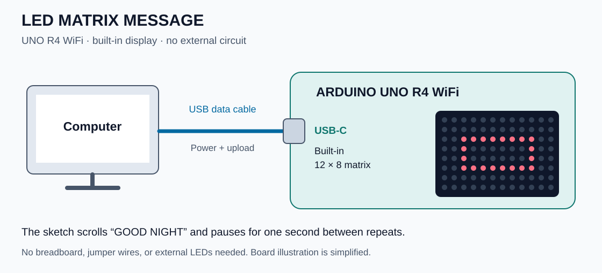

# Arduino UNO R4 WiFi experiments

My collection of projects and small tests while working through the Arduino
UNO R4 WiFi starter kit. Each experiment has its own sketch, circuit diagram,
and notes. Shared commands handle compiling and uploading.

## Projects

| Project | What it does | Status |
| --- | --- | --- |
| [Spaceship Interface](projects/spaceship-interface/README.md) | Planned button-controlled green/red LED interface. | In progress: reads the button; LED behavior pending. |
| [LED matrix message](projects/blink/README.md) | Scrolls **GOOD NIGHT** across the built-in matrix. | Implemented; compile checked. |

### Spaceship Interface — proposed circuit


[Components, pin connections, and project status →](projects/spaceship-interface/README.md)

### LED matrix message — connections



[Project notes and upload instructions →](projects/blink/README.md)

## Getting started

You need an **Arduino UNO R4 WiFi**, a USB data cable, and either
[Arduino CLI](https://docs.arduino.cc/arduino-cli/getting-started/) with `make`,
or the [Arduino IDE](https://docs.arduino.cc/software/ide/).
The shell wrapper and Makefile are intended for macOS/Linux.

From the repository root, install the board core and libraries:

```sh
make setup
make boards
```

`make setup` requires internet access. Copy your board's port from
`make boards`, then compile and upload:

```sh
make compile PROJECT=spaceship-interface
make upload PROJECT=spaceship-interface PORT=/dev/cu.usbmodem123
```

Replace the example port with your own (on Linux, it may look like
`/dev/ttyACM0`). Uploading replaces the sketch currently on the board.
The Spaceship Interface sketch currently configures the pins and reads the
button. The planned LED behavior is not implemented yet.

To run the matrix test:

```sh
make compile PROJECT=blink
make upload PROJECT=blink PORT=/dev/cu.usbmodem123
```

You can also open a project's `.ino` file in Arduino IDE, install the
**Arduino UNO R4 Boards** package, select **Arduino UNO R4 WiFi**, and choose
your port. For the matrix test, also install **ArduinoGraphics** through
Library Manager.

## Commands

| Command | Purpose |
| --- | --- |
| `make projects` | List available projects. |
| `make compile PROJECT=<name>` | Compile one project for UNO R4 WiFi. |
| `make upload PROJECT=<name> PORT=<port>` | Compile and upload one project. |
| `make boards` | List connected boards and ports. |
| `make monitor PORT=<port>` | Open the serial monitor at 115200 baud. |

Omitting `PROJECT` selects `spaceship-interface`. When using the serial
monitor, match its baud rate with `Serial.begin(115200)` in your sketch.

## Repository layout

```text
projects/
  spaceship-interface/
    spaceship-interface.ino
    README.md
    images/circuit.svg
  blink/
    blink.ino
    README.md
    images/circuit.svg
scripts/arduino                 # Arduino CLI wrapper
Makefile                       # Shared project commands
```

To add a project:

1. Create `projects/my-test/my-test.ino` with `setup()` and `loop()` functions.
   The main sketch filename must match its folder name.
2. Add a project `README.md` with components, wiring, behavior, and observations.
3. Put diagrams or photos in that project's `images/` folder and embed them
   using relative links so they also work on GitHub.
4. Run `make compile PROJECT=my-test`, then upload with the same project name.
5. Add the project to the table above. No Makefile changes are needed.

## Local files

`scripts/arduino` keeps downloaded board packages, libraries, caches, and
builds in the ignored `.arduino/` directory. Each project builds separately
in `.arduino/build/<project>/`. Use this wrapper instead of `arduino-cli`
for additional CLI commands in this repository.

The ignore rules also exclude generated firmware, editor settings, `.env`
files, and `arduino_secrets.h`. For future Wi-Fi projects, keep credentials
in an ignored `arduino_secrets.h` beside the sketch and commit an
`arduino_secrets.example.h` with placeholders for others to copy.

The circuit illustrations are editable SVG files stored in the repository.
They show logical connections, not physical breadboard hole positions.

## References

- [Arduino UNO R4 WiFi documentation](https://docs.arduino.cc/hardware/uno-r4-wifi/)
- [UNO R4 WiFi datasheet](https://docs.arduino.cc/resources/datasheets/ABX00087-datasheet.pdf)
- [Built-in LED matrix guide](https://docs.arduino.cc/tutorials/uno-r4-wifi/led-matrix/)
