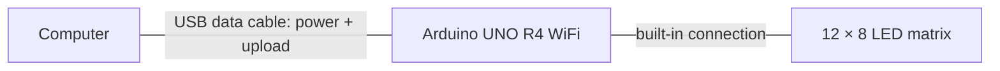

# LED matrix message

Scrolls **GOOD NIGHT** across the Arduino UNO R4 WiFi's built-in LED matrix,
with a one-second pause between repeats. The folder retains the name `blink`
from the original test.

**Status:** implemented and compile checked for UNO R4 WiFi.

## Connections



### Components

- Arduino UNO R4 WiFi.
- USB data cable that fits your computer and the board's USB-C port.

No breadboard, external LEDs, resistors, or jumper wires are required.
The matrix is already connected on the board, as described in the
[Arduino LED matrix guide](https://docs.arduino.cc/tutorials/uno-r4-wifi/led-matrix/).
The diagram is editable Mermaid text in this README and renders directly
on GitHub. Plug the cable into the board’s USB-C port; the matrix needs no
external wiring.

## Compile and upload

The sketch uses **ArduinoGraphics** and the board core's **Arduino_LED_Matrix**
library. From the repository root:

```sh
make setup
make boards
make compile PROJECT=blink
make upload PROJECT=blink PORT=/dev/cu.usbmodem123
```

Replace the example port with the one reported by `make boards`.
After uploading, the matrix should repeatedly scroll the message.

## Customize

Edit the string in `matrix.println()` to change the message, or adjust
`matrix.textScrollSpeed(100)` to change its speed (higher values are slower).
`delay(1000)` controls the pause between repeats, in milliseconds.

Keep the `ArduinoGraphics.h` include before `Arduino_LED_Matrix.h`.

[← All projects](../../README.md)
