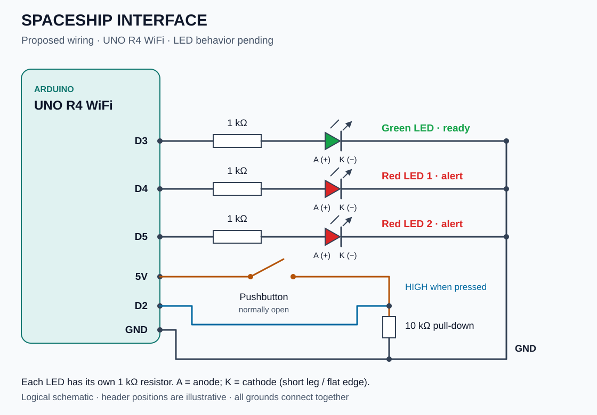

# Spaceship Interface

A starter-kit experiment for the **Arduino UNO R4 WiFi** using a pushbutton,
one green LED, and two red LEDs.

**Status:** in progress. The sketch configures D3–D5 as outputs and reads
the button on D2. The planned LED behavior is not implemented yet.
The circuit below is a proposed setup for this project; it has
not been tested on hardware in this repository.

## Intended behavior

- Button released: green LED on, both red LEDs off.
- Button held: green LED off, red LEDs alternate.

## Circuit



This is a logical schematic, not a breadboard placement diagram. Pin labels
refer to the board headers; their positions in the drawing are illustrative.

### Components

| Quantity | Component |
| --- | --- |
| 1 | Arduino UNO R4 WiFi and USB data cable |
| 1 | Breadboard and jumper wires |
| 1 | Green LED |
| 2 | Red LEDs |
| 3 | 1 kΩ resistors, one per LED |
| 1 | 10 kΩ resistor for the button pull-down |
| 1 | Normally open momentary pushbutton |

### Connections

| Board pin | Connection |
| --- | --- |
| D3 | 1 kΩ resistor → green LED anode (+); LED cathode (−) → GND. |
| D4 | 1 kΩ resistor → first red LED anode (+); LED cathode (−) → GND. |
| D5 | 1 kΩ resistor → second red LED anode (+); LED cathode (−) → GND. |
| D2 | One side of the button, plus a 10 kΩ resistor to GND. |
| 5V | Other side of the button. |
| GND | Common ground for all LED cathodes and the pull-down resistor. |

Use the LED's longer leg as the anode; the shorter leg/flat edge marks the
cathode. A four-legged tactile button has internally connected pairs: use
contacts that connect to each other only when pressed. Disconnect USB power
while changing the wiring.

The UNO R4 WiFi GPIO current limit is **8 mA per pin**, according to the
[Arduino datasheet, section 11.3](https://docs.arduino.cc/resources/datasheets/ABX00087-datasheet.pdf).
This proposed circuit uses **1 kΩ** series resistors: even ignoring the LED
voltage drop, 5 V / 1 kΩ limits current to 5 mA per LED.

With this pull-down circuit, D2 uses `INPUT`: released reads `LOW`,
pressed reads `HIGH`. D3–D5 are configured as `OUTPUT` in the sketch.

## Compile and upload

From the repository root, after `make setup`:

```sh
make boards
make compile PROJECT=spaceship-interface
make upload PROJECT=spaceship-interface PORT=/dev/cu.usbmodem123
```

Replace the example port with the one reported by `make boards`.
The current sketch compiles and reads the button but does not yet control the LEDs.

## Notes

Add a photo of your assembled circuit in `images/` and record any wiring
changes or observations here as you build it.

The SVG is an original illustration for this repository. The intended behavior
and pin assignment follow the familiar Spaceship Interface exercise; see
[Rexhep Mustafovski's example on Arduino Project Hub](https://projecthub.arduino.cc/rexhepmustafovski/arduino-spaceship-alert-interface-system-6c1ad3).
The resistor values above are chosen for this UNO R4 WiFi setup.

[← All projects](../../README.md)
