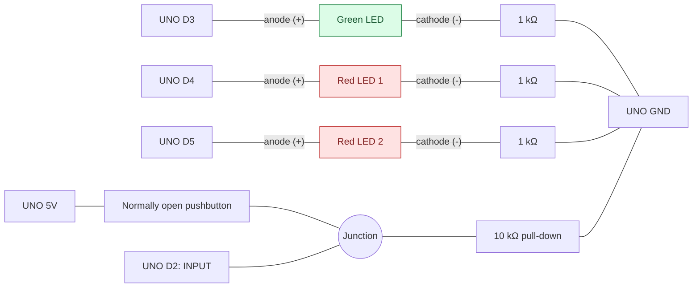

# Spaceship Interface

A starter-kit experiment for the **Arduino UNO R4 WiFi** using a pushbutton,
one green LED, and two red LEDs.

**Status:** the button and LED behavior is implemented in the sketch.
The circuit below is a proposed setup for this project; it has
not been tested on hardware in this repository.

## Behavior

- Button released: green LED on, both red LEDs off.
- Button held: green LED off, red LEDs alternate every 250 ms.

## Circuit



Edit the Mermaid block in this README to change the diagram. GitHub renders
it directly. Lines represent electrical connections, with each LED resistor
between the **cathode (negative leg)** and GND. The junction joins D2, the
button, and the pull-down resistor. This is a logical wiring diagram; it does
not specify breadboard hole positions.

### Components

| Quantity | Component |
| --- | --- |
| 1 | Arduino UNO R4 WiFi and USB data cable |
| 1 | Breadboard and jumper wires |
| 1 | Green LED |
| 2 | Red LEDs |
| 3 | 1 kΩ resistors, one per LED |
| 1 | 10 kΩ resistor for the button pull-down |
| 1 | Normally open momentary pushbutton |

### Connections

| Board pin | Connection |
| --- | --- |
| D3 | Green LED anode (+); LED cathode (−) → 1 kΩ resistor → GND. |
| D4 | First red LED anode (+); LED cathode (−) → 1 kΩ resistor → GND. |
| D5 | Second red LED anode (+); LED cathode (−) → 1 kΩ resistor → GND. |
| D2 | One side of the button, plus a 10 kΩ resistor to GND. |
| 5V | Other side of the button. |
| GND | Common ground for the ground-side ends of all three LED resistors and the pull-down resistor. |

Use the LED's longer leg as the anode; the shorter leg/flat edge marks the
cathode. A four-legged tactile button has internally connected pairs: use
contacts that connect to each other only when pressed. Disconnect USB power
while changing the wiring.

The UNO R4 WiFi GPIO current limit is **8 mA per pin**, according to the
[Arduino datasheet, section 11.3](https://docs.arduino.cc/resources/datasheets/ABX00087-datasheet.pdf).
This proposed circuit uses **1 kΩ** series resistors: even ignoring the LED
voltage drop, 5 V / 1 kΩ limits current to 5 mA per LED.

A current-limiting resistor works on either side of an LED when connected
in series; this diagram places it on the cathode side to match the circuit
being built. [Why either position works](https://sparkfuneducation.com/concept-library/voltage-current-resistance.html).

With this pull-down circuit, D2 uses `INPUT`: released reads `LOW`,
pressed reads `HIGH`. D3–D5 are configured as `OUTPUT` in the sketch.

## Compile and upload

From the repository root, after `make setup`:

```sh
make boards
make compile PROJECT=spaceship-interface
make upload PROJECT=spaceship-interface PORT=/dev/cu.usbmodem123
```

Replace the example port with the one reported by `make boards`.
After upload, check the green light with the button released, then hold the
button to check the alternating red lights.

## Notes

Add a photo of your assembled circuit in `images/` and record any wiring
changes or observations here as you build it.

The Mermaid diagram is maintained as text in this README. The behavior
and pin assignment follow the familiar Spaceship Interface exercise; see
[Rexhep Mustafovski's example on Arduino Project Hub](https://projecthub.arduino.cc/rexhepmustafovski/arduino-spaceship-alert-interface-system-6c1ad3).
The resistor values above are chosen for this UNO R4 WiFi setup.

[← All projects](../../README.md)
